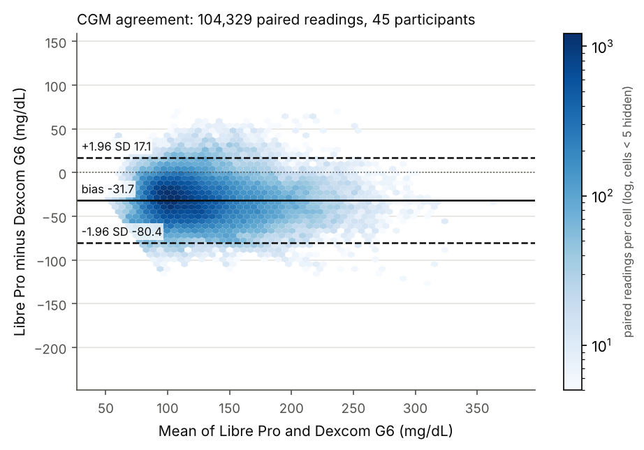
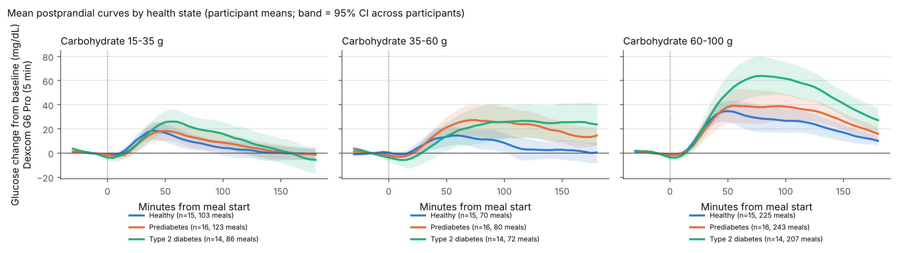
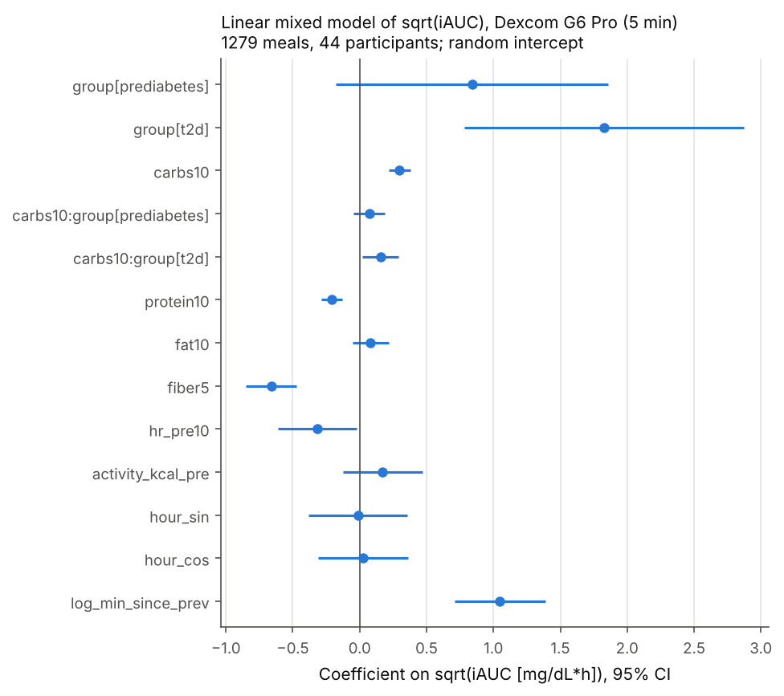
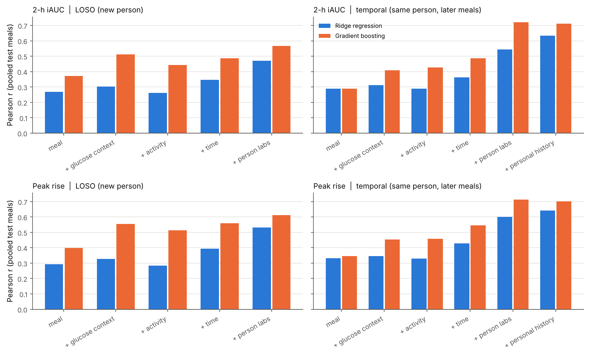
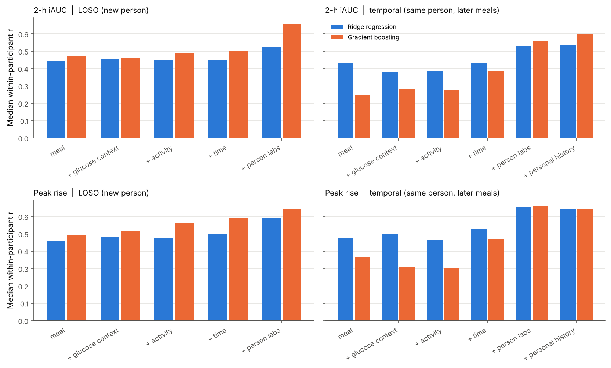

# cgmacros-meal-response

Meal-level glucose responses across metabolic health states (healthy,
prediabetes, type 2 diabetes) on the public **CGMacros** dataset: two
continuous glucose monitors, a wrist wearable, logged meal macronutrients and
clinical labs. The questions:

1. How valid is the glucose signal itself? The two CGMs worn at the same time are compared before any modelling.
2. How do glycemic profiles and postprandial responses differ between healthy, prediabetic and type 2 diabetic participants?
3. Does the same carbohydrate load raise glucose more in prediabetes or type 2 diabetes (carbohydrate × health-state interaction in a mixed model)?
4. What does each data modality add to predicting a meal's response (meal → glucose context → activity → time → person labs), for a **new person** and for **a known person's future meals**?
5. Can participant-level wearable-only or CGM-derived features separate the health-state groups, and how circular is that?

Every number below comes from `python scripts/run_all.py` on CGMacros v1.0.0
(run on 2 Nov 2026; tables in [`results/`](results/)). The analysis is
observational and exploratory; see [Limitations](#limitations).

## Quick start

```bash
python -m venv .venv && source .venv/bin/activate   # Python >= 3.11
pip install -e ".[dev]"
pytest                                # synthetic-data tests only, no dataset needed
python scripts/download_data.py       # ~630 MB zip from PhysioNet, SHA256-checked, CSVs extracted to data/
python scripts/run_all.py             # ~30 min on 4 CPU cores; writes results/
```

`data/` is git-ignored. Raw data, per-meal rows and meal photos are never
written to the repository; the photos are not even extracted from the zip.

## Dataset (as verified)

Checked on the PhysioNet page and in the downloaded files on 2 Nov 2026.

| Item | What was found |
|---|---|
| Source | PhysioNet, *CGMacros: a scientific dataset for personalized nutrition and diet monitoring*, v1.0.0, published 28 Jan 2025, doi:[10.13026/3z8q-x658](https://doi.org/10.13026/3z8q-x658) |
| Access | **Open access**: "Anyone can access the files, as long as they conform to the terms of the specified license." No credentialing or data-use agreement |
| Licence | **CC BY-NC-SA 4.0**. Non-commercial use with attribution; adaptations must be shared under the same licence. The `LICENSE.txt` inside the release is empty (its SHA256 is that of an empty file); the licence is stated on the project page |
| Study | Sansum Diabetes Research Institute and Texas A&M; Advarra IRB Pro00049227; ClinicalTrials.gov NCT04991142; recruited 2021–2024 |
| Participants | 45 (ids 1–49 with gaps): **15 healthy (HbA1c < 5.7 %), 16 prediabetes (5.7–6.4 %), 14 type 2 diabetes (> 6.4 %)**, age 18–69. Recomputing the groups from `bio.csv` HbA1c reproduces 15 / 16 / 14 |
| Design | about 10 days of free living. Breakfasts were protein shakes with varied macronutrients; lunches came from one fast-casual restaurant chain; dinners were self-selected. Participants were asked to leave ≥ 3 h between breakfast, lunch and dinner. Meals were logged in MyFitnessPal and photographed before and after eating; meal times come from the photos |
| CGM | **Two devices worn at the same time, both blinded**: Abbott FreeStyle Libre Pro on the upper arm (15-min sampling) and Dexcom G6 Pro on the abdomen (5-min sampling) |
| File layout | `bio.csv` (demographics, anthropometrics, fasting labs, three finger-stick readings), `microbes.csv` (1,979 bacteria present/absent), `gut_health_test.csv` (Viome scores), and one `CGMacros-0XX/CGMacros-0XX.csv` per participant on a 1-minute grid, plus `photos/` |
| CGM in the files | Both glucose columns are **linearly interpolated to 1 min**. The knots of the piecewise-linear series sit every 15 min (Libre) and every 5 min (Dexcom) (see [below](#leakage-from-interpolated-cgm)). 105,913 native Dexcom and 41,928 native Libre readings were reconstructed |
| Wearable (Fitbit Sense) | `HR` (bpm, every file) and `Calories (Activity)` (kcal/min; 44 of 45 files, missing for participant 7). 34 files have `METs` (×10); the other 11 have only an ordinal `Intensity` (0–3) instead. **There are no step counts** except in one file (participant 7). Median HR missingness per participant is 7.0 % |
| Meal fields | `Meal Type` (spelling and case vary; also includes snacks), `Calories`, `Carbs`, `Protein`, `Fat`, `Fiber` (g), `Amount Consumed` (%, absent in 2 files; one value of 900), `Image path`. 1,706 meal records |
| Labs (screening, day 1) | HbA1c (%; the data dictionary says "mmol/mol" but the values 4.6–8.5 are %), fasting glucose, fasting insulin, triglycerides, total / HDL / non-HDL / LDL / VLDL cholesterol (LDL = 800 and VLDL = 400 are documented error codes and set to missing) |
| Dates | **Shifted** by the providers: "time shifted by +/- N days (365<N<720)". Time of day is kept |
| Recording length | median 10.6 days per participant; some files contain timestamp jumps (2, 3 or 901 min) |
| Photos | 3,454 photo files in the archive; 1,644 / 1,706 meal records (1,552 / 1,609 eating episodes) have a photo. **Not modelled in this version** |

Groups follow the dataset definition, which matches the ADA HbA1c cut-points.
With HbA1c reported to 0.1 %, "> 6.4 %" is the same as "≥ 6.5 %".

| Group (median) | n | Age | BMI | HbA1c % | Fasting glucose mg/dL | Fasting insulin µU/mL | Male % |
|---|---|---|---|---|---|---|---|
| Healthy | 15 | 40 | 25.8 | 5.3 | 96 | 9.3 | 33 |
| Prediabetes | 16 | 54 | 32.8 | 5.95 | 110.5 | 17.5 | 31 |
| Type 2 diabetes | 14 | 52.5 | 30.6 | 7.1 | 149 | 13.2 | 43 |

The healthy group is younger and leaner, so group contrasts below are not
adjusted for age or BMI.

## Methods

### Package layout

| Module | Role |
|---|---|
| `cgmeal.io` | loader; harmonises column variants; reconstructs native CGM readings; participant table and HbA1c group |
| `cgmeal.glycemic` | glycemic metrics, MAGE, interpolation with gap rules, CGM-to-CGM agreement (bias, MARD, Bland–Altman), lag scan |
| `cgmeal.meals` | eating episodes, plausibility and overlap rules, postprandial response (baseline, iAUC, peak rise, time to peak), exclusion counts |
| `cgmeal.features` | per-meal predictors by modality, strictly pre-meal unless labelled post-meal |
| `cgmeal.stats` | Kruskal–Wallis, Mann–Whitney with Holm correction, Cliff's delta |
| `cgmeal.models` | linear mixed model with carbohydrate × group interaction |
| `cgmeal.predict` | LOSO and within-person temporal evaluation, modality ablation |
| `cgmeal.classify` | participant-level group classification with a permutation test |
| `cgmeal.plots` | figures (aggregated data only) |

### Leakage from interpolated CGM

The provider's 1-minute glucose value at a meal start that falls between two
native readings is interpolated toward the *next* reading. Part of it is
therefore measured after the meal starts. Using it as a "pre-meal glucose"
feature would leak the response into the predictor. `io.native_readings`
recovers the native readings as the knots of the piecewise-linear series:
segment ends, plus every point where the slope changes, using the actual time
steps. Every glucose metric and pre-meal feature uses only those readings, at
or before the meal time. `tests/test_features.py` checks this: it changes all
native readings after t0, rebuilds the 1-min interpolation, and asserts that
every pre-meal feature is unchanged even though the interpolated value at t0
is not. The issue was found independently here. It is also the subject of a
2026 preprint listed on the PhysioNet page (Saha 2026, Zenodo, not peer
reviewed): for the Libre series, it confirms the 15-min-to-1-min linear
interpolation, shows that features at intermediate minutes recover the next
native reading and inflate forecasting R², and notes that knots of collinear
readings are invisible and that missed readings appear as irregular
2–7-min (and 901-min) timestamp steps. It does not discuss Dexcom flat
stretches.

**Collinear readings vs gaps.** Readings that lie exactly on a straight line
with their neighbours (a flat stretch, or a constant rise of e.g. 2 mg/dL per
5 min) leave no knot, so two recovered readings can be more than three native
periods apart without any data being missing. Over the whole Dexcom record
there are 494 flat and 529 sloped long intervals of this kind (20–70 min,
mostly 20–25 min), against 108 intervals that contain a missing value or an
irregular timestamp. Dexcom G6 reports whole mg/dL (99.5 % of recovered
readings are integers). If the provider had interpolated across a missed
reading, the hidden 5-min points of a 20-min stretch would be integers only
when the end-to-end change is divisible by 4 (about 25 % of the time), but
**all 529 sloped stretches have integer values at every hidden 5-min point**.
So they are real collinear readings. The gap rule therefore treats an
interval longer than three native periods as missing data only if the
provider's 1-min series has a missing value or a non-1-min timestamp step
inside it, or if it is longer than 60 min (`io.COLLINEAR_MAX_MIN`). This cap
guards against implausible cases such as one 795-min flat Libre stretch.
Shorter flat and sloped stretches on a regular grid are used.

### Glycemic metrics (per participant, per device)

Mean, SD and CV = 100·SD/mean. Times in range follow the international
consensus thresholds (Battelino et al. 2019): TIR 70–180, TBR < 70 and < 54,
TAR > 180 and > 250 mg/dL. Time in 70–140 mg/dL is reported because TIR
70–180 saturates in people without diabetes; Danne et al. (2017, Table 1)
list 70–140 mg/dL as the secondary target range. For CV, Danne et al. (2017,
Section 5 and Table 1) define stable glucose as CV < 36 % and unstable as
CV ≥ 36 %, and Battelino et al. (2019, Table 2) give a target of CV ≤ 36 %.
MAGE (Service et al. 1970) uses a documented simplified
variant in the spirit of Baghurst (2011): turning points are found, pairs
with amplitude < 1 SD are iteratively removed while the more extreme peak or
nadir is kept, and the remaining amplitudes are averaged in the direction of
the first qualifying excursion. MAGE implementations differ, so absolute
values are not comparable across software.

### CGM-to-CGM agreement (validity check)

Each native Dexcom reading is paired with the Libre series interpolated at the
same time, only while both sensors were recording. Reported: bias (Libre minus
Dexcom), MARD relative to Dexcom, and Pearson r. Bland–Altman 95 % limits of
agreement (Bland & Altman 1986) handle repeated readings per person in a
simplified variance-components form (SD² = between-participant variance of
mean differences + mean within-participant variance; after Bland & Altman
2007), and the bias weights each participant equally. Neither device is a
laboratory reference, so MARD here is device-vs-device. A lag scan
(−20 … +20 min) checks whether a time offset explains the disagreement.

### Meal responses

* **Episodes**: meal records starting within 30 min of an episode's first record are merged and their nutrients summed (1,706 records → 1,609 episodes).
* **Implausible entries** are excluded: energy = 0, fibre > carbohydrate + 1 g, or logged energy outside 0.5–2× the Atwater estimate (4C + 4P + 9F).
* **Overlap**: an episode is excluded if another episode starts < 120 min later. Earlier meals are not an exclusion; time since the previous episode is a predictor.
* **Missing CGM**: the device needs ≥ 1 native reading in [−30, 0] min, and the readings must span [0, 120] min with no gap. An interval longer than three native periods (15 min Dexcom, 45 min Libre) is a gap only if it contains a missing value or an irregular timestamp, or is longer than 60 min (see [collinear readings](#leakage-from-interpolated-cgm)).
* **Baseline** = mean of native readings in [−30, 0] min. **iAUC** (mg/dL·h) = area above baseline over 0–120 min, ignoring area below baseline (the incremental-area convention of the glycaemic-index method; Brouns et al. 2005), integrated exactly on the piecewise-linear curve including baseline crossings. **Peak rise** = max over 0–120 min − baseline; **time to peak** = time of that max.
* **Primary device**: Dexcom G6 Pro, chosen before looking at outcomes because its 5-min sampling resolves the peak better. Libre Pro is the replication.

Sequential exclusions (each episode counted at its first failing rule):

| | Dexcom | Libre |
|---|---|---|
| Eating episodes | 1,609 | 1,609 |
| Implausible nutrients | 96 | 96 |
| Next meal < 120 min later | 133 | 133 |
| No baseline reading | 19 | 23 |
| CGM not covering 0–120 min | 17 | 6 |
| CGM gap in window | 4 | 10 |
| **Eligible meals** | **1,340** (45 participants) | **1,341** |

By group and device: [`results/table_meal_exclusions.csv`](results/table_meal_exclusions.csv).

**Gap rule, before and after.** The first version of this analysis treated
every interval longer than three native periods as a gap and excluded 115
Dexcom meals (14 Libre). Split by cause, the 115 Dexcom exclusions were:

| Cause of the long interval | Dexcom meals | Libre meals |
|---|---|---|
| True gap: missing values or irregular timestamps (still excluded) | 4 (all in one prediabetes participant) | 5 |
| Flat (constant-value) stretch only | 33 | 6 |
| Sloped collinear stretch only | 75 | 3 |
| Both flat and sloped stretches | 3 | 0 |

Flat and sloped stretches were redundant exclusions (see above), so they are
now used: 111 of the 115 Dexcom meals return (33 flat, 75 sloped, 3 both).
Of the 14 Libre meals, 4 return (3 sloped and 1 flat stretch of exactly
60 min). The 10 that stay excluded are 5 true gaps (all in participant 7) and
5 flat stretches longer than 60 min (75–795 min). Exclusions for "not
covering the window" and "no baseline" are unchanged.

**The 120-min rule differs by health state**
([`table_overlap_exclusion_by_group.csv`](results/table_overlap_exclusion_by_group.csv)):

| Group | Plausible episodes | Excluded (next meal < 120 min) | % | Per-participant % (median [IQR]) |
|---|---|---|---|---|
| Healthy | 539 | 75 | 13.9 % | 9.7 [6.9, 19.4] |
| Prediabetes | 556 | 38 | 6.8 % | 6.1 [0.0, 8.5] |
| T2D | 418 | 20 | 4.8 % | 3.2 [0.0, 6.3] |

Per-participant shares differ by group (Kruskal–Wallis p = 0.01). Healthy
participants ate again within 2 h about three times as often as T2D
participants, so the rule removes more of their meals. The excluded episodes
are mainly snacks (71 of 133) and dinners (54), usually a snack eaten less
than 2 h before dinner (73 of the following episodes are dinners) or a
dinner followed by a snack (52). The retained meals are therefore somewhat
less representative of everyday eating in the healthy group.

### Features by modality (`cgmeal.features`)

| Group | Features | Window |
|---|---|---|
| meal | carbohydrate, protein, fat, fibre (g), energy (kcal) | logged |
| glucose context | pre-meal glucose (= baseline), trend (OLS slope of native readings in [−30, 0] min), mean of [−120, 0] min | native readings ≤ t0 |
| activity | mean HR, mean activity kcal/min, mean METs | [t0 − 60, t0) |
| time | time of day (sin, cos), log minutes since the previous episode (capped at 12 h) | |
| person | age, sex, BMI, HbA1c, fasting glucose, fasting insulin, triglycerides, HDL | screening |
| *post-meal activity (secondary only)* | mean HR, activity kcal/min, METs | [t0, t0 + 120) |

METs are missing for the 11 participants who have only `Intensity`. Gradient
boosting handles missing values natively; ridge uses median imputation plus
missingness indicators.

### Statistics

* **Group differences**: the unit of analysis is the participant. Each person's meal-level responses are reduced to their median first, so meals are not treated as independent. With 14–16 people per group and skewed metrics, comparisons are rank-based: Kruskal–Wallis with η²_H = (H − k + 1)/(n − k), and pairwise two-sided Mann–Whitney tests with Holm correction over the three pairs and Cliff's δ. Kruskal–Wallis p-values are also Holm-adjusted across the metrics of each table.
* **Average curves**: for three carbohydrate ranges (15–35, 35–60, 60–100 g), glucose change from baseline on a 5-min grid (−30 to 180 min). Each participant's curves are averaged first, then averaged across participants, with a t-based 95 % CI across participants.
* **Mixed model** (`statsmodels` MixedLM, REML): √iAUC ~ carbs/10 g × group + protein/10 g + fat/10 g + fibre/5 g + pre-meal HR/10 bpm + pre-meal activity kcal/min + time of day (sin, cos) + log minutes since previous meal; continuous predictors grand-mean centred; random intercept per participant. A random carbohydrate slope is kept only if a likelihood-ratio test against the intercept-only model (ML fits; p from a 50:50 χ²₁/χ²₂ mixture) gives p < 0.05. *Why √iAUC*: the residual skewness was 0.85 untransformed and −0.93 with log(iAUC + 1), because about 9 % of meals produce essentially no rise (iAUC < 1 mg/dL·h) and form a long left tail on the log scale. With √iAUC it was −0.14. log(iAUC + 1) is reported as a sensitivity analysis, together with a model that adds pre-meal glucose and a Libre replication. To make √-scale coefficients readable, back-transformed predicted iAUC by group at 30 / 60 / 90 g carbohydrate is also reported (other covariates at their means, random effect 0).
* **Prediction**: targets are 2-h iAUC and peak rise (Dexcom). Ridge regression chooses its penalty by an inner GroupKFold over participants on the training rows only. Histogram gradient boosting uses fixed settings chosen before running (learning rate 0.05, 300 iterations, 15 leaves, min 20 samples per leaf, L2 = 1). Two settings:
  * (a) **LOSO**: each participant is predicted by a model trained on the other 44.
  * (b) **Temporal**: for each participant, the earliest 70 % of eligible meals train and the later 30 % test (919 / 421 meals), with one model for everyone; tests confirm every training meal precedes every test meal of that person. In this setting an extra step adds **personal history**: the participant's mean outcome in their own training meals (leave-one-out for training rows), which never uses test outcomes.
  * The LOSO predictions are also scored on exactly the 421 temporal test meals, so the two settings can be compared on identical meals.
  * Reported: pooled Pearson r, R² and MAE over test meals, plus the median and IQR across participants of within-participant r, R² and MAE (participants with ≥ 5 test meals).
* **Group classification (secondary)**: participant-level multinomial logistic regression (L2, C = 1, no tuning; median imputation; standardisation), leave-one-participant-out, balanced accuracy, macro-F1, and a 200-permutation label test. Feature sets: wearable-only (median, 5th percentile and SD of HR, night-time median HR, mean activity kcal/min, mean METs); CGM-derived (Dexcom mean, SD, CV, TIR, time 70–140, TAR > 180, MAGE, median meal iAUC / peak rise / time to peak); and both. Labs are excluded because they define the groups.

## Results

### 1. The two CGMs disagree substantially (validity check)



104,329 paired readings from all 45 participants:

| | Bias (Libre − Dexcom) | 95 % LoA | MARD vs Dexcom | r |
|---|---|---|---|---|
| All | **−31.7 mg/dL** | −80.4 to +17.1 | 24.9 % | 0.83 |
| Healthy | −36.9 | −77.6 to +3.9 | 30.0 % | 0.69 |
| Prediabetes | −29.8 | −75.5 to +15.9 | 24.1 % | 0.76 |
| Type 2 diabetes | −28.2 | −86.9 to +30.5 | 20.3 % | 0.83 |

The Libre Pro reads lower than the Dexcom G6 Pro in nearly everyone: the
median participant bias is −32.9 mg/dL (IQR −39.7 to −24.9). A time offset
does not explain this. Within-participant correlation is highest with the
Libre series shifted by −5 min (median r 0.833 vs 0.817 at 0 min), while the
bias stays at about −33 mg/dL at every lag from −20 to +20 min
([`table_cgm_lag_scan.csv`](results/table_cgm_lag_scan.csv)).

The data cannot say which device is closer to plasma glucose, because there
is no reference measurement during wear. The practical consequence is large,
though. **Absolute CGM metrics depend on the device**: by Libre, healthy
participants spend a median 14.9 % of the time below 70 mg/dL, against 0.2 %
by Dexcom; their median mean glucose is 84 vs 117 mg/dL. Incremental measures
(iAUC, peak rise) subtract the device's own baseline and are much less
affected, and the two devices give the same group ordering below.

### 2. Glycemic profiles by health state

Dexcom, per participant (median per group; Kruskal–Wallis; full tables:
[`table_glycemic_by_group_dexcom.csv`](results/table_glycemic_by_group_dexcom.csv),
[`..._libre.csv`](results/table_glycemic_by_group_libre.csv)):

| Metric | Healthy | Prediabetes | T2D | KW p | η²_H | Cliff's δ healthy→T2D |
|---|---|---|---|---|---|---|
| Mean glucose (mg/dL) | 117 | 129 | 156 | 7.5e-5 | 0.41 | 0.86 |
| SD (mg/dL) | 20.1 | 25.8 | 40.0 | 2.0e-5 | 0.47 | 0.91 |
| CV (%) | 17.1 | 19.6 | 23.2 | 7.8e-4 | 0.29 | 0.76 |
| TIR 70–180 (%) | 97.9 | 95.0 | 79.2 | 3.3e-5 | 0.44 | −0.91 |
| Time 70–140 (%) | 84.6 | 74.6 | 30.9 | 7.3e-5 | 0.41 | −0.85 |
| TAR > 180 (%) | 1.1 | 3.9 | 20.4 | 1.8e-5 | 0.47 | 0.91 |
| MAGE (mg/dL) | 48.2 | 63.2 | 104.7 | 7.3e-6 | 0.52 | 0.91 |

Every variability and exposure metric rises monotonically from healthy to
prediabetes to T2D. All of these survive Holm correction across metrics; TBR
does not. Prediabetes differs from healthy on MAGE (Holm p = 0.006), SD
(0.02), TAR > 180 (0.02) and mean glucose (0.03), but not clearly on TIR
70–180 (0.055), which is near ceiling in both groups. Every participant has
a Dexcom CV below the 36 % stability threshold (maximum 33.3 %, in T2D). By
Libre, 3 participants are at or above it (1 prediabetes, 2 T2D;
[`table_cv_threshold_by_group.csv`](results/table_cv_threshold_by_group.csv)).
In this cohort the threshold does not separate the groups.

### 3. Postprandial responses by health state



Per-participant median response (Dexcom, all eligible meals; [`table_meal_response_by_group.csv`](results/table_meal_response_by_group.csv)):

| | Healthy | Prediabetes | T2D | KW p | η²_H | Holm p healthy vs T2D (δ) |
|---|---|---|---|---|---|---|
| iAUC 0–2 h (mg/dL·h) | 27.9 | 45.3 | 62.0 | 0.003 | 0.23 | 0.003 (0.72) |
| Peak rise (mg/dL) | 36.8 | 47.5 | 64.2 | 0.001 | 0.27 | 0.001 (0.77) |
| Time to peak (min) | 54 | 68.2 | 77.5 | 4e-4 | 0.32 | 2e-4 (0.88) |

Within carbohydrate ranges, the group difference is clear for **60–100 g**
meals: iAUC 43.0 / 66.1 / 85.8, KW p = 0.001, healthy vs T2D Holm p = 0.002;
peak rise 44.5 / 64.5 / 87.0, p = 5e-4, with T2D also above prediabetes (Holm
p = 0.027). Median carbohydrate is 73–74 g in all three groups. For 15–35 g
the omnibus test is borderline (iAUC p = 0.0495, no pairwise difference
after Holm), and for 35–60 g there is no clear difference (p = 0.14).
Overall, prediabetes sits between the other two groups but does not differ
significantly from either after Holm correction on Dexcom. The Libre
replication shows the same ordering (iAUC 23.3 / 39.3 / 54.5, p = 0.005). In
T2D the curves also peak later and stay elevated at 2–3 h.

### 4. Mixed model: carbohydrate × health state



1,279 Dexcom meals from 44 participants. Participant 7 drops out because the
file has no activity-energy column. The random carbohydrate slope did not
improve fit (LRT = 3.87, p = 0.097), so the model has a random intercept only
(variance 1.70 vs residual 9.28 on the √ scale). Each model is fitted with
L-BFGS, BFGS, Powell and Nelder–Mead, and the converged fit with the highest
finite log-likelihood is kept. Here that was BFGS; on this meal set L-BFGS
stopped at a degenerate point with infinite log-likelihood and zero
random-intercept variance.

Carbohydrate slope within each group (√iAUC per 10 g, 95 % CI):

| Group | Slope | 95 % CI |
|---|---|---|
| Healthy | 0.298 | 0.215 – 0.380 |
| Prediabetes | 0.369 | 0.273 – 0.464 |
| T2D | 0.453 | 0.334 – 0.572 |

**T2D × carbohydrate interaction:** +0.155 per 10 g (95 % CI 0.017 to
0.292, p = 0.027). It is consistent across all four variants: Libre
replication +0.147 (0.017 to 0.277, p = 0.027); log(iAUC + 1) +0.060 (0.004
to 0.115, p = 0.034); with pre-meal glucose added +0.135 (0.011 to 0.259,
p = 0.033). **Prediabetes × carbohydrate:** +0.071 (−0.045 to 0.187,
p = 0.23), not supported. Back-transformed for a typical participant
([`table_mixed_model_predicted_iauc.csv`](results/table_mixed_model_predicted_iauc.csv)):

| Predicted iAUC (mg/dL·h) | 30 g | 60 g | 90 g |
|---|---|---|---|
| Healthy | 21.9 (15.4–29.6) | 31.1 (23.5–39.7) | 41.9 (32.5–52.4) |
| Prediabetes | 28.4 (20.8–37.1) | 41.4 (32.7–51.1) | 56.9 (45.7–69.2) |
| T2D | 37.0 (27.9–47.5) | 55.4 (44.7–67.2) | 77.4 (63.0–93.3) |

**Answer to Q3**: in T2D the same carbohydrate load is associated with a
larger response, both as a higher level (main effect +1.82, p = 6e-4) and
as a steeper slope. At 90 g the predicted iAUC is about 1.8× that of the
healthy group. In prediabetes the response is intermediate, and a steeper
slope is not supported. Treat the T2D slope result as **fragile**:
p ≈ 0.03 in each variant, no correction for testing two interactions, 44
participants, and in the first run of this analysis, which excluded 111
additional meals under a stricter gap rule (see
[Meal responses](#meal-responses)), the same term was +0.128 (p = 0.079).

Other fixed effects (primary model): protein −0.206 per 10 g (p = 3e-7),
fibre −0.661 per 5 g (p = 7e-12), and longer time since the previous meal
+1.05 per log-minute (p = 1e-9) were associated with the response. Fat (p =
0.22) and time of day (p > 0.8) were not. Higher pre-meal HR was associated
with a smaller response (−0.32 per 10 bpm, p = 0.033), but not once pre-meal
glucose was added (p = 0.38). Meal composition is partly fixed by design
(shakes, one restaurant chain), so these are associations within this menu,
not general nutritional effects.

### 5. Prediction and modality ablation



Test meals: LOSO covers all 1,340 eligible meals (45 participants). The
temporal split trains on 919 and tests on 421 later meals (44 participants
with ≥ 5 test meals). To compare like with like, the table shows LOSO
predictions **scored on the same 421 temporal test meals**. "Within-person r"
is the median and IQR across participants of the correlation within each
person's test meals. Target: 2-h iAUC (Dexcom). Full table, including peak
rise and LOSO on all meals:
[`table_prediction_ablation.csv`](results/table_prediction_ablation.csv).

| Features (cumulative) | Model | LOSO r / R² / MAE | LOSO within-person r | Temporal r / R² / MAE | Temporal within-person r |
|---|---|---|---|---|---|
| meal | GBM | 0.35 / 0.10 / 33.8 | 0.42 [0.23, 0.64] | 0.29 / 0.00 / 35.3 | 0.25 [0.04, 0.61] |
| + glucose context | GBM | 0.41 / 0.09 / 33.7 | 0.47 [0.30, 0.59] | 0.41 / 0.07 / 34.4 | 0.28 [0.09, 0.51] |
| + activity (pre-meal) | GBM | 0.38 / 0.06 / 34.7 | 0.37 [0.20, 0.56] | 0.43 / 0.09 / 34.8 | 0.27 [0.03, 0.49] |
| + time | GBM | 0.42 / 0.09 / 34.0 | 0.45 [0.23, 0.59] | 0.49 / 0.15 / 33.4 | 0.38 [0.23, 0.64] |
| + person labs | GBM | 0.54 / 0.25 / 30.2 | 0.60 [0.45, 0.76] | **0.72 / 0.51 / 25.1** | 0.56 [0.44, 0.75] |
| + personal history (temporal only) | GBM | – | – | 0.71 / 0.50 / 26.2 | 0.60 [0.34, 0.76] |
| meal | Ridge | 0.28 / 0.07 / 34.8 | 0.50 [0.26, 0.56] | 0.29 / 0.07 / 34.7 | 0.43 [0.27, 0.58] |
| + glucose context | Ridge | 0.30 / 0.09 / 34.5 | 0.43 [0.29, 0.59] | 0.31 / 0.09 / 34.4 | 0.38 [0.23, 0.57] |
| + activity (pre-meal) | Ridge | 0.25 / 0.06 / 35.4 | 0.37 [0.25, 0.60] | 0.29 / 0.07 / 34.9 | 0.39 [0.20, 0.56] |
| + time | Ridge | 0.33 / 0.10 / 34.3 | 0.49 [0.22, 0.59] | 0.36 / 0.12 / 33.9 | 0.43 [0.22, 0.59] |
| + person labs | Ridge | 0.48 / 0.23 / 32.1 | 0.54 [0.30, 0.70] | 0.54 / 0.29 / 31.0 | 0.53 [0.31, 0.68] |
| + personal history (temporal only) | Ridge | – | – | **0.63 / 0.40 / 28.5** | 0.54 [0.37, 0.70] |

MAE is in mg/dL·h; the median iAUC of eligible meals is 37.7. The bar chart
above shows pooled r with LOSO scored on all meals. On all 1,340 meals, the
full LOSO models reach r = 0.57 (GBM) and 0.47 (ridge) for iAUC, and 0.61
and 0.53 for peak rise.

What the ablation shows:

* **Meal macronutrients alone** give modest accuracy for a new person (pooled r ≈ 0.3; R² ≤ 0.13).
* **Glucose context** helps gradient boosting (LOSO on all meals: r 0.37 → 0.51) more than ridge, which suggests a non-linear baseline effect.
* **Pre-meal wearable activity gave no consistent gain.** It lowered LOSO accuracy in both models. In the temporal setting, GBM r rose slightly (0.41 → 0.43) while MAE worsened (34.4 → 34.8). In this free-living data a 60-min window of HR / activity energy / METs (METs missing for 11 people) carries little usable signal. Post-meal activity, the secondary and *not deployable* analysis, adds a little (LOSO GBM r 0.57 → 0.61 on all meals).
* **Person labs add the most** of any modality for a new person (LOSO GBM r 0.49 → 0.57 on all meals).
* **Personalisation**: on identical test meals, a model that has seen the person's earlier meals beats a new-person model (GBM r 0.54 → 0.72, R² 0.25 → 0.51, MAE 30.2 → 25.1). For gradient boosting the gain already appears with person labs, because the lab values identify the individual and the trees learn their level. Ridge needs the explicit personal-history feature (r 0.54 → 0.63).
* **The gain is mostly about level, not ranking**: within-person r is 0.54–0.60 in both settings. Knowing the person sets their typical response size; ranking one person's meals against each other is no better.
* Peak rise follows the same pattern (temporal GBM with labs r = 0.71, R² = 0.50 vs LOSO r = 0.58 on the same meals). Gradient boosting with few features shows unstable within-person r in the temporal setting (meal-only median 0.25), which suggests it overfits 919 training meals.



### 6. Can wearable or CGM features separate the groups? (secondary)

| Features (participant level) | Balanced accuracy (LOO) | Macro-F1 | Permutation p (200) |
|---|---|---|---|
| Wearable only | 0.28 | 0.26 | 0.58 |
| CGM-derived | 0.50 | 0.50 | 0.010 |
| Wearable + CGM | 0.56 | 0.56 | 0.005 |

Chance is about 0.29 under permutation. **Wearable-only features did not
separate the groups**: no wearable feature differed by group (all
Kruskal–Wallis p ≥ 0.1;
[`table_wearable_by_group.csv`](results/table_wearable_by_group.csv)). CGM
features did better than chance but were far from diagnostic. Most errors
involve prediabetes, which was classified correctly in only 5 of 16
participants with CGM features and 7 of 16 with both feature sets.

**Circularity**: the groups are defined by HbA1c, so labs are excluded here.
CGM features remain partly circular, because HbA1c reflects average glucose
over roughly three months and mean CGM glucose estimates the same quantity
over 10 days. A CGM "classifier" is therefore largely re-measuring the
grouping variable with a noisier, shorter window. The modest accuracy says
more about the noise of 10-day CGM and of the 5.7 / 6.5 % cut-points than
about new information. Wearable features are not circular in this sense, but
they could be confounded by age and BMI.

## Interpretation

* **Measurement first.** Two blinded sensors worn at the same time (arm and abdomen) differ by about 32 mg/dL on average. Group comparisons and incremental responses agree across devices, but absolute thresholds (TIR, TBR, "hypoglycaemia" in healthy people) should not be read from one blinded sensor without a reference.
* **Health state matters for meal responses.** From healthy to prediabetes to T2D, responses are larger, peak later and last longer. The clearest difference is for larger (60–100 g) carbohydrate loads. In T2D the carbohydrate slope is steeper (p ≈ 0.03 in all four model variants), but this is fragile with 44 people. In prediabetes a steeper slope is not supported.
* **What each modality adds.** Meal macronutrients alone explain under 10 % of meal-to-meal variance for a new person. Glucose context and person-level labs add the most. Pre-meal wearable activity adds nothing (or slightly hurts) in this free-living dataset. A person's own past meals raise R² from 0.25 to 0.51 on the same test meals, mainly by fixing their typical response level rather than by ranking their meals better.
* This is consistent in spirit with the personalised-nutrition argument of Zeevi et al. (2015), that the same meal produces person-specific responses. But this dataset has 45 people, not 800, and no microbiome features were used here.

## Limitations

* **Small sample**: 45 participants and 14–16 per group. Group effect sizes have wide uncertainty, the classification is LOO on 45 points, and no result has been replicated in an independent cohort.
* **Free-living, self-reported meals**: MyFitnessPal macronutrients are estimates. Meal start comes from photos. "Amount consumed" was not used to rescale nutrients, because the data dictionary says nutrients describe the consumed meal and the field has implausible values (e.g. 900 %). Meal composition is partly fixed by design, so macronutrients are correlated with meal type and time of day.
* **Observational, not causal**: all associations (protein, fibre, HR, time since the previous meal) may be confounded, e.g. by meal type, by what people choose to eat, or by insulin and medication use, which is not in the dataset.
* **No glucose reference**: the device disagreement cannot be resolved. The Libre bias may vary with wear day, and sensor warm-up periods were not removed.
* **Groups from one HbA1c measurement**: borderline participants (e.g. HbA1c 5.6 vs 5.7 %) are labelled differently. Diabetes medication is unknown.
* **Interpolation reconstruction**: exactly collinear readings cannot be recovered. Long intervals on a regular 1-min grid are treated as collinear readings (supported for Dexcom by the integer test). For Libre, a stretch up to 60 min could in principle still hide a missed reading that the provider interpolated without marking it. A stricter rule changed the T2D slope result from p = 0.079 to p = 0.027 (see section 4).
* **Exclusions are not random**: the 120-min rule removes 13.9 % of healthy, 6.8 % of prediabetic and 4.8 % of T2D meals (mostly a snack shortly before dinner, or a dinner followed by a snack), and CGM rules remove data-poor periods.
* **Prediction scores are optimistic about deployment**: meal timing and macronutrients are known exactly here; in practice they would be estimated.
* MAGE is a simplified variant. iAUC is the positive-area convention; other conventions (net AUC, total AUC) give different numbers.
* Photos and microbiome data were not modelled.

## Parameter choices to review

All are module-level constants: `meals.MERGE_WINDOW_MIN = 30`, `meals.WINDOW_MIN = 120`, `meals.BASELINE_MIN = 30`, the plausibility rule (`meals.implausible`), `io.MAX_GAP_MIN = {dexcom: 15, libre: 45}`, `io.COLLINEAR_MAX_MIN = 60`, `features.ACTIVITY_PRE_MIN = 60`, the time-since-previous-meal cap of 12 h, `predict.TRAIN_FRAC = 0.7`, `predict.GBM_PARAMS`, the carbohydrate bins in `scripts/run_all.py`, Dexcom as primary device, √iAUC as the mixed-model scale, and the MAGE variant.

## References

* Das A, Kerr D, Glantz N, Bevier W, Santiago R, Gutierrez-Osuna R, Mortazavi BJ. CGMacros: a pilot scientific dataset for personalized nutrition and diet monitoring. *Sci Data*. 2025;12:1557. doi:10.1038/s41597-025-05851-7
* Gutierrez-Osuna R, Kerr D, Mortazavi B, Das A. CGMacros: a scientific dataset for personalized nutrition and diet monitoring (version 1.0.0). *PhysioNet*. 2025. doi:10.13026/3z8q-x658
* Pollard T, Moody BE, Lehman L, Gow B, Fernandes C, Xie C, Johnson A, Mark RG, Heldt T. PhysioNet as a global platform for biomedical research. *Nature Health*. 2026;1(8):792–795. doi:10.1038/s44360-026-00096-z (the standard PhysioNet citation requested on the dataset page).
* Zeevi D, Korem T, Zmora N, et al. Personalized nutrition by prediction of glycemic responses. *Cell*. 2015;163(5):1079–1094. doi:10.1016/j.cell.2015.11.001
* Battelino T, Danne T, Bergenstal RM, et al. Clinical targets for continuous glucose monitoring data interpretation: recommendations from the international consensus on time in range. *Diabetes Care*. 2019;42(8):1593–1603. doi:10.2337/dci19-0028
* Service FJ, Molnar GD, Rosevear JW, Ackerman E, Gatewood LC, Taylor WF. Mean amplitude of glycemic excursions, a measure of diabetic instability. *Diabetes*. 1970;19(9):644–655.
* Baghurst PA. Calculating the mean amplitude of glycemic excursion from continuous glucose monitoring data: an automated algorithm. *Diabetes Technol Ther*. 2011;13(3):296–302. doi:10.1089/dia.2010.0090
* Danne T, Nimri R, Battelino T, et al. International consensus on use of continuous glucose monitoring. *Diabetes Care*. 2017;40(12):1631–1640. doi:10.2337/dc17-1600
* Saha P. Auditing CGMacros: interpolated glucose series leak the future, and a leak-free participant-held-out benchmark for glucose forecasting. Preprint, *Zenodo*. 2026. doi:10.5281/zenodo.23526696
* Brouns F, Björck I, Frayn KN, Gibbs AL, Lang V, Slama G, Wolever TMS. Glycaemic index methodology. *Nutr Res Rev*. 2005;18(1):145–171. doi:10.1079/NRR2005100
* Bland JM, Altman DG. Statistical methods for assessing agreement between two methods of clinical measurement. *Lancet*. 1986;1(8476):307–310. doi:10.1016/S0140-6736(86)90837-8
* Bland JM, Altman DG. Agreement between methods of measurement with multiple observations per individual. *J Biopharm Stat*. 2007;17(4):571–582. doi:10.1080/10543400701329422

## Licence

Code: MIT (see [`LICENSE`](LICENSE)), © lizxu-byte. The dataset is **not**
included. Files in `results/` are derived from CGMacros and are shared under
the dataset's **CC BY-NC-SA 4.0** licence; see [`results/README.md`](results/README.md).
Use of the data must follow the PhysioNet licence terms, including
non-commercial use and attribution.
